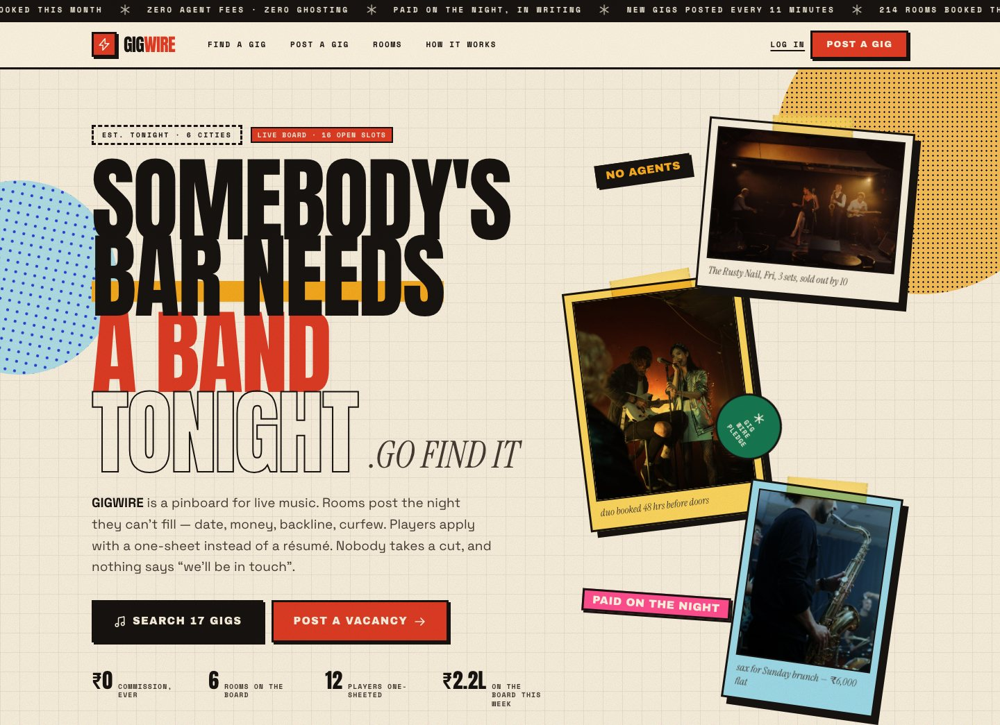
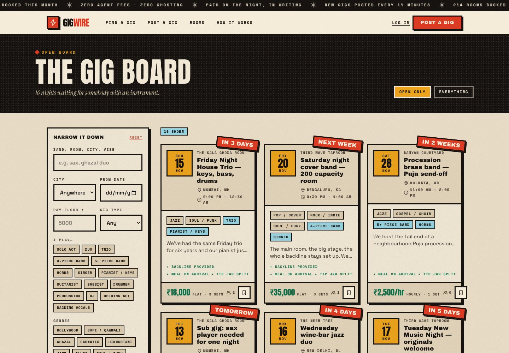
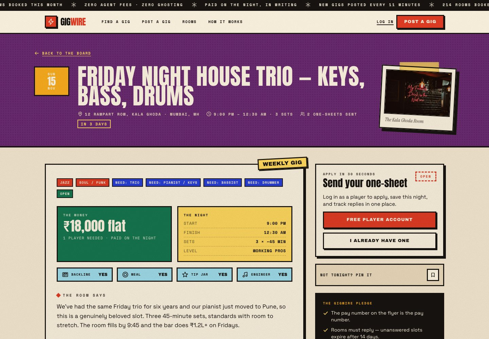
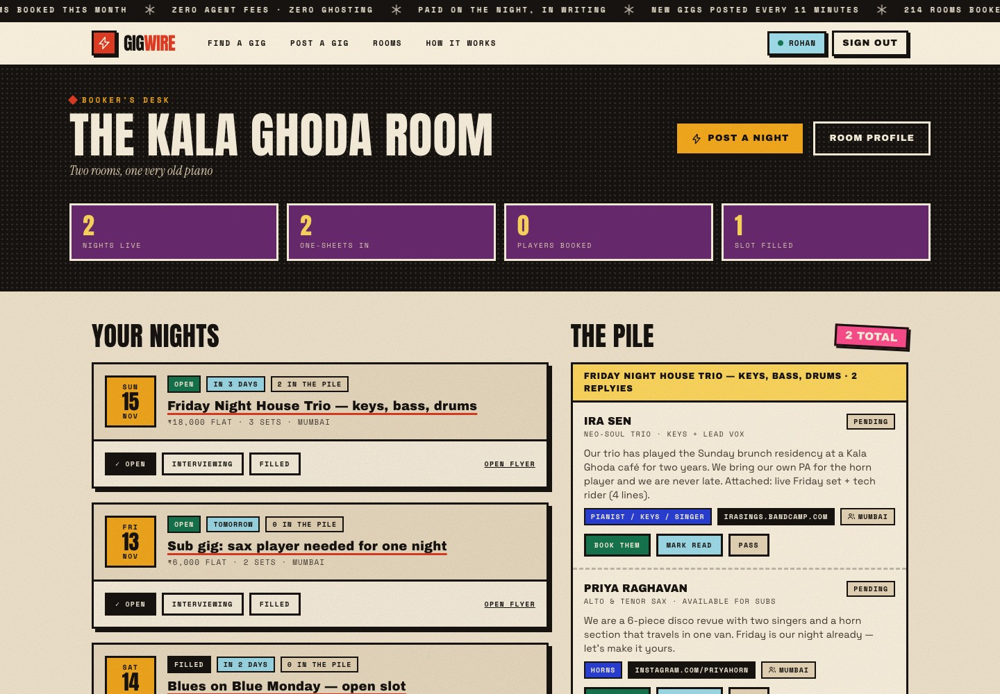
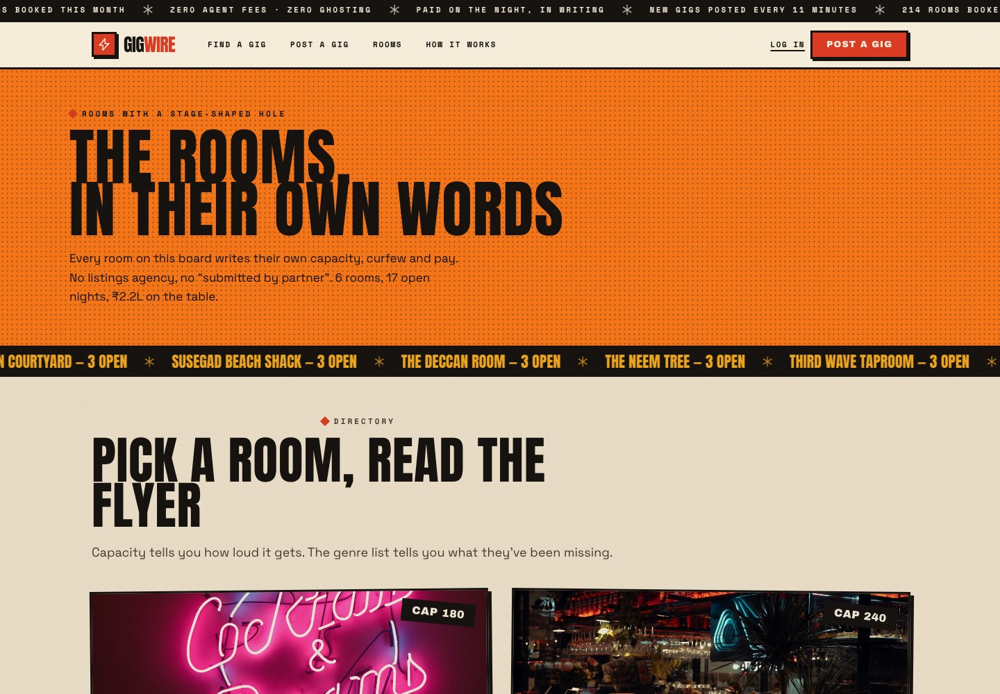
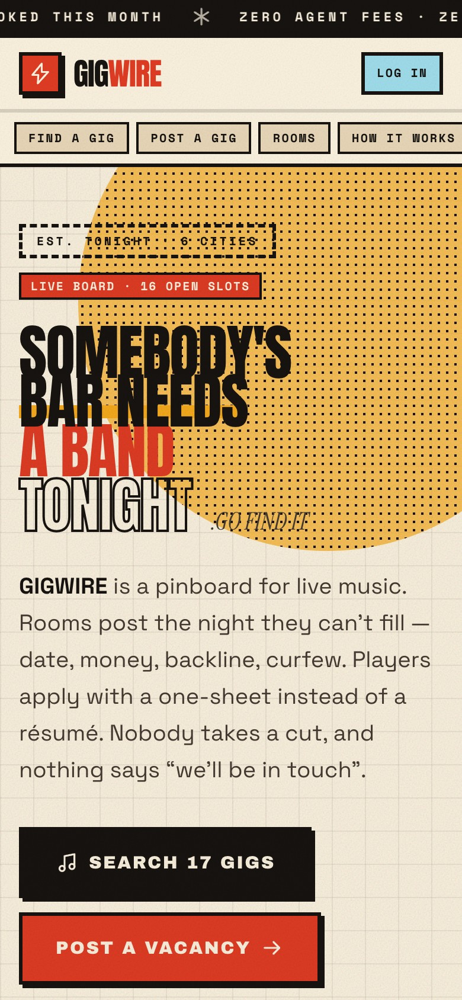
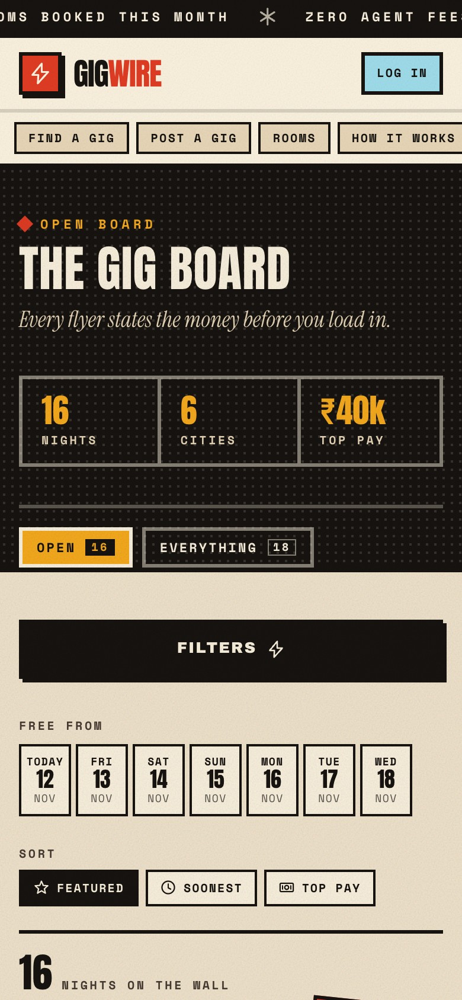
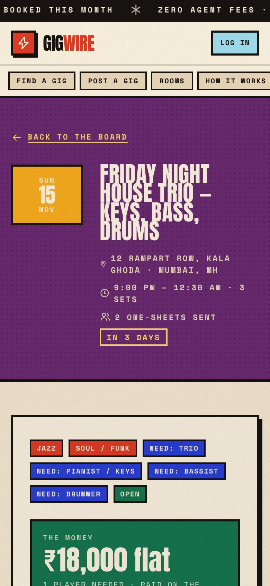

<p align="center">
  
</p>

<h1 align="center">GIGWIRE</h1>

<p align="center">
  <em>Somebody's bar needs a band tonight.</em><br />
  A handmade gig board for live music in India — rooms post the night, players send a one-sheet,<br />
  and everybody gets paid on the night.
</p>

<p align="center">
  <a href="https://abhinav-prabhakar.github.io/Gigwire/"></a>
  
  
  
  
  
  
</p>

<p align="center">
  <a href="https://abhinav-prabhakar.github.io/Gigwire/"><b>▶ gigwire demo</b></a>
  &nbsp;·&nbsp;
  <a href="DESIGN.md"><b>Design system</b></a>
  &nbsp;·&nbsp;
  <a href="#run-it-locally"><b>Run it locally</b></a>
</p>



---

<table>
  <tr>
    <td width="50%">
      <h3>🎸 For players</h3>
      <p>Filter by city, date, pay floor and the exact seat a room is missing. Send a one-sheet — two sentences and a link — and track every reply in one place.</p>
    </td>
    <td width="50%">
      <h3>🏮 For rooms</h3>
      <p>Write a flyer in ninety seconds: date, money, set lengths, backline, curfew. Applications land in a pile you can book, read or pass with one click.</p>
    </td>
  </tr>
</table>

<table>
  <tr>
    <td width="50%"></td>
    <td width="50%"></td>
  </tr>
  <tr>
    <td align="center"><sub><b>The board</b> — 18 India-first nights, filtered in memory</sub></td>
    <td align="center"><sub><b>The flyer</b> — pay, perks and a 30-second one-sheet</sub></td>
  </tr>
</table>

<table>
  <tr>
    <td width="50%"></td>
    <td width="50%"></td>
  </tr>
  <tr>
    <td align="center"><sub><b>The desk</b> — nights, replies, one-click status</sub></td>
    <td align="center"><sub><b>The rooms</b> — capacity, curfew, pay in their own words</sub></td>
  </tr>
</table>

---

<h2 align="center">Built for the phone in your back pocket</h2>

<p align="center">
  
  &nbsp;
  
  &nbsp;
  
</p>

---

## Try the demo

The live build is a **static demo**: accounts, applications, posts and bookmarks live in your browser's `localStorage`. Nothing is sent anywhere.

Pick a pair of shoes on the [login screen](https://abhinav-prabhakar.github.io/Gigwire/login/) — password is **`gigwire`** for every account.

| Account | Role | What to try |
| --- | --- | --- |
| `rohan@kalaghodaroom.in` | Room — The Kala Ghoda Room, Mumbai | Mark a night filled, book an applicant, post a flyer |
| `ananya@thirdwavetaproom.in` | Room — Third Wave Taproom, Bengaluru | Edit the room profile and watch flyers update |
| `ira@nightowlbookings.in` | Player — neo-soul trio | Apply, save a night, withdraw an application |
| `priya@hornline.in` | Player — sax, available for subs | Send a one-sheet and track replies |

> **India-first by default.** Mumbai, Bengaluru, New Delhi, Anjuna (Goa), Pune and Kolkata; ₹ everywhere; Indian venues, musicians, genres and gig copy.

---

## Under the hood

- **Next.js 16** App Router with `output: "export"` — 32 static pages, zero server.
- **Tailwind CSS 4** design tokens in `src/app/globals.css`; no component library.
- **In-memory query layer** (`src/lib/demo/data.ts`) stands in for Postgres, so filters and sorting still work.
- **localStorage store** (`src/lib/demo/store.ts`) emulates auth, bookmarks, applications and status changes.
- **Dates anchored to build day** (`NEXT_PUBLIC_BUILD_DAY`) so the board never looks stale.
- **Self-hosted photography** in `public/photos/` — no hotlinking, works offline.
- **Full metadata**: OG/Twitter cards, JSON-LD, sitemap, robots, web manifest, PNG + SVG favicons.

<details>
<summary><b>Project map</b></summary>

```
src/app/            routes (home, gigs, rooms, post, dashboard, profile, auth)
src/components/     header, footer, gig card, forms, UI primitives
src/lib/demo/       seed data, in-memory queries, localStorage store
src/lib/site.ts     site constants, base path and absolute URLs
public/photos/      bundled demo photography
public/             icons, favicon, og.png, manifest
scripts/            photo fetch, brand assets, QA + README screenshots
server/api/         the original Postgres route handlers (kept for reference)
DESIGN.md           the complete design system
```

</details>

---

<h2 id="run-it-locally">Run it locally</h2>

```bash
git clone https://github.com/Abhinav-Prabhakar/Gigwire.git
cd Gigwire
npm install
npm run dev
```

Open **http://localhost:3000**. No database, no environment variables.

Build the GitHub Pages version (adds the `/Gigwire` base path):

```bash
GITHUB_PAGES=1 npm run build
npx serve out
```

Deploy it — Pages serves the **`main` branch `/docs`** folder, so there is no workflow to wait for:

```bash
./scripts/build-docs.sh          # build + sync out/ into docs/
git add docs && git commit -m "Deploy" && git push
```

Regenerate the brand assets and screenshots:

```bash
node scripts/fetch-photos.mjs          # public/photos/
python3 scripts/brand-assets.py        # favicons + og.png (needs Playwright)
python3 scripts/readme-shots.py        # docs/ (serve out/ first)
```

---

<p align="center">
  <sub>Built by <a href="https://github.com/Abhinav-Prabhakar">Abhinav Prabhakar</a> · design system in <a href="DESIGN.md">DESIGN.md</a> · MIT</sub><br />
  <sub>GIGWIRE is a design demo, not a real booking service. No agents were harmed.</sub>
</p>
